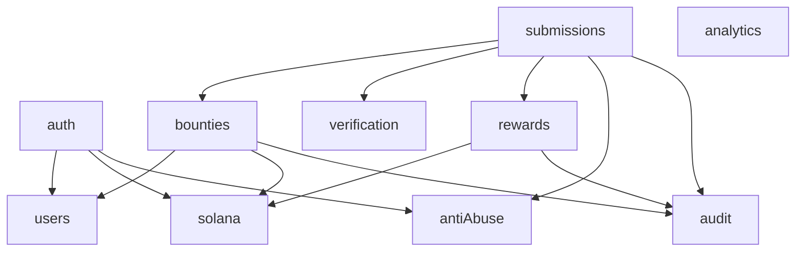
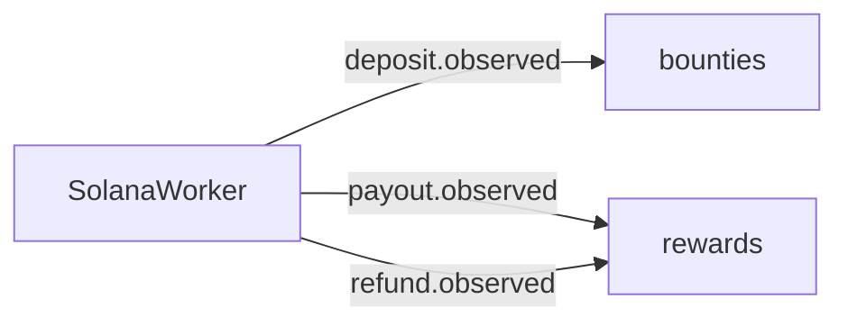

# Backend architecture

Status: module boundaries exist under `apps/api/src/modules`. Wallet login routes exist. Nonce issue, signature checks, user upsert, and nonce replay passed against a disposable PostgreSQL database. Session lifetime and CSRF are still open. The confirmation worker, bounty, submission, verification, payout, and analytics workflows are not implemented. The process serves `GET /health`, `GET /health/ready`, Swagger at `/docs`, and `/auth/nonce`, `/auth/login`, `/auth/session`, and `/auth/logout`. Routes are unversioned.

`anti-abuse` provides an in-memory rate limiter. Nonce issuance uses the proposed limit of 10 requests per minute per wallet. Submission limits are not applied. There is no Redis. `SessionGuard` can be attached to later routes. CSRF protection is not implemented. A missing treasury key, auth secret, or answer-encryption key does not stop startup. `DATABASE_URL` is required only when `NODE_ENV` is `production`. In development and test the API starts without it. A configured URL that fails to connect is logged and reported by readiness. Auth routes then return 503. Liveness still responds.

Related: [system architecture](SYSTEM_ARCHITECTURE.md), [database design](DATABASE_DESIGN.md), [blockchain design](BLOCKCHAIN_DESIGN.md), [coding standards](../development/CODING_STANDARDS.md), [ADR-001](../decisions/ADR-001-modular-monolith.md).

## Style

The API is a modular monolith (CD-03). One deployable process hosts every module. Modules talk through injected services or Nest events. They do not talk through the network.

The original sketch listed a notifications module. It is not part of this monolith. No MVP requirement needs outbound notifications (PRD reconciliation C4). Payout and submission status are queried.

## Modules

| Module | Owns | Must not own |
| --- | --- | --- |
| `auth` | Nonces, signature login, session issue and revoke. Routes exist. Persistence is unproven until the migration is applied | Chain transfers, answer checks |
| `users` | Wallet user and role | Bounty rules |
| `bounties` | Bounty lifecycle, encrypted answer, public DTOs, deposit records | Payout sends |
| `submissions` | Consent, solving sessions, attempts, orchestration of grade-then-maybe-reserve | Treasury signing |
| `verification` | Pure compare of expected answer, method, and submitted text | HTTP, database writes, payouts |
| `rewards` | Ledger postings, allocations, payout rows, refund requests | Grading text |
| `analytics` | Read-model aggregates for the four ADR-009 metrics | Writes to payouts or attempts |
| `solana` | Local signature verify, RPC reads, treasury transfers, confirmation polling | Product authorization |
| `anti-abuse` | Rate limits | Business rules for rewards |
| `audit` | Append-only audit rows | Decisions about whether an action is allowed |

`rewards` and `solana` are the only modules that create or advance payout transfers. `verification` is deterministic and has no I/O.

## Dependencies

Allowed direction is downward in that graph. In particular:

- `solana` does not import `auth`, `bounties`, `submissions`, or `rewards`.
- `verification` does not import another domain module.
- `analytics` reads persistence. It imports no other domain module and does not grade.
- The session guard supplies `userId`. `submissions` does not import `users`.
- `auth` may call `solana` only for local Ed25519 checks. Login must work when RPC is down.

The confirmation worker lives in `solana` and emits events. `bounties` subscribes to deposit observations. `rewards` subscribes to payout and refund observations. That event hop is what avoids a cycle.

PD-16 (**proposed — pending confirmation**): the worker is an in-process scheduler, not a separate queue cluster.

## Request paths

### Create bounty

`bounties` validates the Zod body, computes principal in lamports, encrypts the expected answer (PD-02), inserts the bounty and its single question (PD-01), and writes an audit row. Status is `draft` until a deposit is announced, then `funding_pending`.

### Announce deposit

`bounties` stores the creator-supplied signature as pending after a cheap shape check. It does not mark the bounty active in that request. The worker later asks `solana` for the transaction and emits `deposit.observed`.

### Start session

`submissions` checks the authenticated user, stored consent (PD-09), bounty activity, deadline, and allocation cap, then inserts one solving session with the server clock. `anti-abuse` may reject the call first (PD-20).

### Submit answer

`submissions` loads the session, rejects client clocks and client correctness, checks the attempt limit, asks `bounties` for the decrypted expected answer through an internal method, calls `verification`, and writes the attempt.

If the attempt is correct, `submissions` calls `rewards` inside the same database transaction to apply E1. `rewards` either inserts the allocation, ledger move, and `pending` payout, or returns a capacity ineligibility reason.

After commit, `rewards` asks `solana` to send if a payout is `pending`. The HTTP response does not wait for `confirmed`.

### Analytics

`analytics` checks the session on the server. A creator receives the four [ADR-009](../decisions/ADR-009-minimal-research-analytics.md) aggregates only for bounties they own. An administrator may receive those same aggregates for the platform, for one bounty, or grouped by creator ([ADR-010](../decisions/ADR-010-role-based-analytics-visibility.md)). Research export is not an MVP method. Analytics responses omit solver wallet addresses and individual research records. Analytics do not decide eligibility. Hiding a control is not the check. Operational account and moderation routes are a separate authorization path and do not return those research records.

## Transaction boundaries

Use one database transaction for each of these commit points:

| Commit | Writes |
| --- | --- |
| Create bounty | Bounty, question, audit |
| Confirm deposit | Funding row, ledger `funded` and `refundable`, bounty `active`, audit. Unique on chain signature |
| Start session | Consent row written in this transaction when the request includes acceptance, or already present. Session insert and audit |
| Submit incorrect or ineligible correct | Attempt and audit. Session becomes `completed` when the attempt limit is exhausted or the correct attempt is capacity-ineligible |
| Submit eligible correct | Attempt, allocation, ledger move from refundable to reserved, payout `pending`, session `completed`, audit. If the allocation count reaches max rewarded solvers, also set bounty `closed` with reason `fully_allocated` |
| Confirm payout | Payout `confirmed`, ledger reserved to paid, chain transaction row, audit. Unique on signature |
| Close bounty | Status, close reason, audit. No lamport movement |
| Confirm refund (P1) | Ledger refundable to refunded, chain transaction, audit |

The eligible-correct transaction locks the bounty row so two solvers cannot both take the last slot. Proposed mechanism: Prisma interactive transaction plus a row lock on the bounty.

A bounty with status `active` and a deadline at or before server time is not joinable. The request that observes that condition closes it with reason `deadline` in the same transaction that rejects the session or submit. Marketplace queries use the same server-time rule.

The cluster send is outside the database transaction. A crash after commit and before send leaves a `pending` payout. The worker retries that row (PAY-006).

Do not hold a database transaction open across RPC.

## Authorization

| Route class | Rule |
| --- | --- |
| Public read | Active marketplace fields only |
| Authenticated | Valid session |
| Owner | `bounty.creatorId` equals the session user |
| Admin | Server role `admin` from the allowlist (PD-04). Platform analytics and operational administration are separate checks ([ADR-010](../decisions/ADR-010-role-based-analytics-visibility.md)) |

Unknown bounty IDs and bounties owned by someone else use the same not-found response on private routes when that avoids confirming that an ID exists. Forbidden is acceptable on admin routes.

## Error handling

Domain errors map to HTTP through one filter. Controllers do not invent their own error JSON.

| Condition | HTTP | Stable code |
| --- | --- | --- |
| Bad body | 400 | `VALIDATION_ERROR` |
| Missing or bad session | 401 | `UNAUTHENTICATED` |
| Bad signature or nonce | 401 | `AUTH_REJECTED` |
| Not owner or not admin | 403 | `FORBIDDEN` |
| Missing public bounty | 404 | `NOT_FOUND` |
| Reused nonce, duplicate reward, bounty not active, attempt limit | 409 | `CONFLICT` |
| Rate limit | 429 | `RATE_LIMITED` |
| Unexpected | 500 | `INTERNAL` |

Readiness is not an error envelope. When PostgreSQL is configured and unreachable, `GET /health/ready` returns 503 with `{ "status": "not_ready", "checks": { "database": "down" } }`. Other 503 responses use code `NOT_READY`.

Conflict responses include a specific machine reason where the client must render it, such as `ATTEMPT_LIMIT_REACHED`, `BOUNTY_NOT_ACTIVE`, `DEADLINE_PASSED`, or `REWARD_ALREADY_ALLOCATED`. They do not include the expected answer.

Payout capacity outcomes for an otherwise valid correct submit are 200 results with an ineligibility reason, not 500s. The attempt is stored. Reasons: `pool_exhausted`, `insufficient_refundable`.

Validation source is Zod (PD-17, **proposed — pending confirmation**). OpenAPI is generated from those schemas when the API is scaffolded. Do not keep a second hand-written contract that can drift.

## Logging

Use structured logs with `requestId`, `userId`, `bountyId`, `payoutId`, and `action` when those exist. The current request log records `requestId`, method, path without the query string, and status code. It does not log bodies. Redact expected answers, submitted answers, explanations, authorization headers, cookies, session tokens, signed secret keys, treasury material, and postgres URLs. Unexpected errors return `INTERNAL` and `Internal server error`. The response does not include a stack or the exception message.

Log chain signatures. They are public.

## Configuration

Proposed environment names, all server-side:

| Name | Use |
| --- | --- |
| `DATABASE_URL` | Pooled Postgres connection for the API runtime |
| `DIRECT_URL` | Direct Postgres connection for Prisma CLI migrations. The API adapter does not use it |
| `SOLANA_RPC_URL` | Devnet RPC |
| `TREASURY_SECRET_KEY` | Devnet custodial signer ([ADR-006](../decisions/ADR-006-devnet-treasury-private-key-storage.md)). Backend environment only. Not a Mainnet custody strategy |
| `ANSWER_ENCRYPTION_KEY` | Expected-answer encryption (PD-02) |
| `AUTH_TOKEN_SECRET` | Still present in configuration. [ADR-003](../decisions/ADR-003-postgresql-server-side-sessions.md) does not sign session tokens with it |
| `ADMIN_WALLET_ALLOWLIST` | Comma-separated wallets (PD-04) |
| `CORS_ORIGIN` | Comma-separated browser origins. Default `http://localhost:3000` |
| `JSON_BODY_LIMIT` | JSON body limit. Default `64kb` |
| `PORT` | HTTP port. Default `3001` |

Missing treasury configuration disables sends. It must not crash public reads. That rule is in force for the health endpoints. Sends are not implemented.

## Process model

One API process serves HTTP and the confirmation tick. A hackathon demo does not add Redis, a second worker service, or Kubernetes. If the process restarts, `pending` and `submitted` rows are the recovery queue.

Horizontal scaling is out of scope. The bounty row lock is the concurrency control for the last reward slot on a single database.
