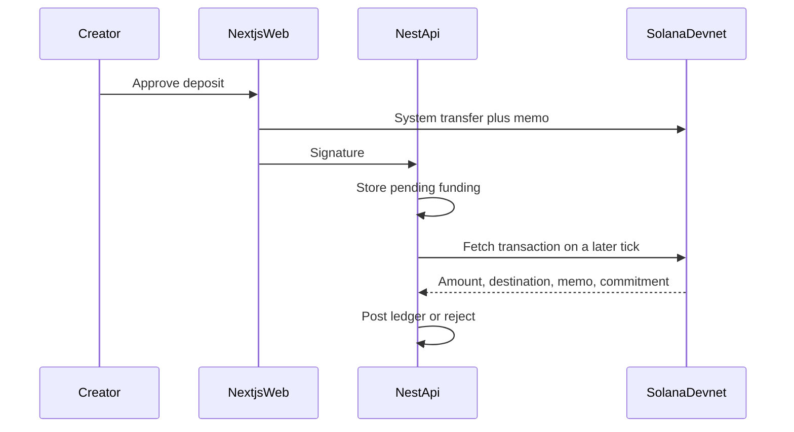
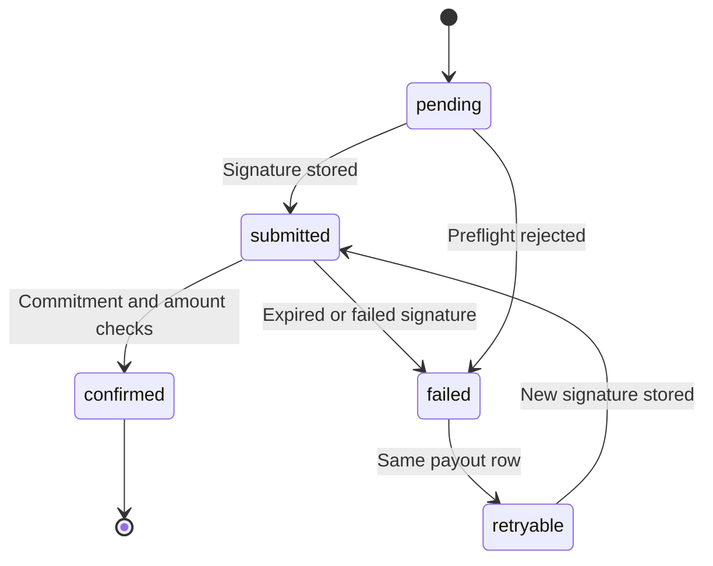

# Blockchain design

Status: design intent for Solana Devnet. The API selects a Devnet RPC URL and does not build, sign, or send a transfer. No treasury key is stored in this repository. The treasury is custodial. It is not trustless escrow. See [ADR-002](../decisions/ADR-002-custodial-devnet-treasury.md).

Related: [system architecture](SYSTEM_ARCHITECTURE.md), [database design](DATABASE_DESIGN.md), [PRD](../product/PRD.md).

## Scope

MVP chain work uses `@solana/web3.js` and the native SOL system program (CD-05, PAY-017).

In scope:

- Wallet signature checks for login.
- Creator deposits to a backend treasury.
- Deposit verification.
- Solver payouts.
- Confirmation and idempotent retry.
- After the deadline or the participant cap, unallocated principal is platform revenue ([ADR-008](../decisions/ADR-008-unused-reward-pool-retention.md)). Retention is not implemented.

Out of scope: custom programs, program-derived escrow, USDC, mainnet, and multisig. Those need a new ADR.

## Wallets

| Wallet | Held by | Role |
| --- | --- | --- |
| Creator | User, in Phantom | Signs login and the deposit |
| Solver | User, in Phantom | Signs login. Receives SOL. Does not sign the payout |
| Treasury | API process | Receives deposits and signs solver payouts. ADR-008 does not refund unused principal after deadline or the participant cap |

[ADR-006](../decisions/ADR-006-devnet-treasury-private-key-storage.md): `TREASURY_SECRET_KEY` is an environment variable on the API host for the Devnet MVP. It is never committed, logged, stored in PostgreSQL, or sent to the browser. PD-02's `ANSWER_ENCRYPTION_KEY` is a different variable. This is not the Mainnet custody strategy. Signing is not implemented.

The login message is not a transaction. Proposed message fields: domain, wallet address, nonce, issued-at, expiration, chain `solana:devnet`, and a sentence that the signature does not approve a transfer. Verification is local Ed25519 and must not require RPC.

## Custodial treasury

One Devnet keypair receives every bounty principal for the hackathon. Internal `BountyLedgerEntry` rows say which bounty owns which lamports. The chain does not enforce that split.

Consequences:

- The operator can move treasury SOL. The product must not pretend otherwise.
- A bug in ledger code can pay the wrong wallet. Unique allocations and idempotent sends are the controls.
- Demo balances stay small. Devnet SOL is not valuable, and the design is still unsafe for mainnet.

Network fees are paid from a fee buffer that is treasury SOL outside bounty principal (PD-07, **proposed — pending confirmation**). A suggested demo buffer is 0.1 SOL, which is an operational top-up, not a product parameter. If the buffer cannot pay a fee, the payout stays `retryable` and the bounty principal stays `reserved`.

## Amounts

1 SOL = 1_000_000_000 lamports. The example bounty is 0.01 SOL per solver and 100 solvers, so the solver reward pool is 1 SOL = 1_000_000_000 lamports. All comparisons use integers.

[ADR-007](../decisions/ADR-007-company-platform-commission.md) adds a 5% commission on that pool: 50_000_000 lamports. The creator's total payment is 1_050_000_000 lamports. The confirmed reward-pool deposit is bounty principal. Commission is not principal and is not included in `funded`. CD-12's 0% fee is superseded. The on-chain split and the commission receiving address are not specified. Commission handling is not implemented. Network fees remain the separate PD-07 fee buffer.

## Deposits

1. The API creates the bounty and a unique `depositReference`.
2. The creator UI shows the treasury address, the principal in lamports, and the memo.
3. The creator signs a system transfer in Phantom.
4. The client reports the signature. The API stores `BountyFunding` as `pending` and returns.
5. The worker loads the transaction. It activates the bounty only when all checks pass:
   - Commitment is `confirmed` ([ADR-005](../decisions/ADR-005-solana-confirmed-commitment.md)). `processed` is not sufficient. `finalized` is not required. Execution must succeed, and the sender, recipient, amount, and memo must match.
   - Destination is the treasury.
   - Source is the creator wallet that owns the bounty.
   - The transfer is native SOL, not a token.
   - Memo is `sb:deposit:<bountyId>:<reference>` (PD-18).
   - Amount is at least the principal.

PD-21 (**proposed — pending confirmation**): lamports above the principal are accepted. They increase `funded` and `refundable`. A shortfall, wrong destination, wrong memo, or wrong source rejects the funding row and leaves the bounty inactive. The same signature is never posted twice (PAY-015).



## Bounty balance

Ledger identity:

```text
funded = reserved + paid + refundable + refunded
```

| Bucket | Meaning |
| --- | --- |
| `funded` | Cumulative confirmed deposits. Does not decrease |
| `reserved` | Allocated to a solver whose payout is not confirmed |
| `paid` | Confirmed solver payouts |
| `refundable` | Unallocated reward-pool principal. After the deadline or the participant cap, [ADR-008](../decisions/ADR-008-unused-reward-pool-retention.md) retains the remainder as platform revenue. It is not `paid` |
| `refunded` | Stays in the identity. ADR-008 does not use it for that retained remainder |

`refunded` stays in the identity. Product UI still leads with funded, reserved, paid, and the unallocated remainder (PD-06). ADR-008 does not move the retained remainder into `paid`.

Reservation and settlement rules are in the database design. The chain send never happens inside the database transaction that moves funds to `reserved`.

## Solver payouts

Payout timing is [ADR-004](../decisions/ADR-004-immediate-individual-solver-payouts.md): the first eligible correct attempt pays that solver immediately. There is no ranking and no creator batch. The HTTP submission returns before chain confirmation. Payouts are not implemented. Confirmation commitment is [ADR-005](../decisions/ADR-005-solana-confirmed-commitment.md).

Eligibility rule E1, verbatim:

A reward allocation is created only inside one database transaction when the submission attempt is verified correct, the attempt belongs to the authenticated solver's solving session, a consent record exists, the attempt number is within the bounty attempt limit, the bounty is active, the server time is at or before the deadline, that solver has no allocation on that bounty, the number of allocations is below max rewarded solvers, and refundable lamports are at least the reward. The same transaction moves the reward from refundable to reserved and inserts one payout in `pending`. The chain transfer happens after the transaction commits. A correct attempt that fails only the capacity checks (allocation cap or refundable balance) is stored with an ineligibility reason and creates no payout. Requests that fail consent, ownership, attempt limit, bounty activity, or deadline are rejected and store no attempt.

After commit:

1. Load the `pending` payout by its idempotency key `payout:<bountyId>:<walletAddress>` (PAY-009).
2. If status is `submitted` or `confirmed`, do not sign another transfer.
3. If status is `pending` or `retryable`, build a system transfer from the treasury to the solver for `amountLamports`, with memo `sb:payout:<payoutId>` (PD-18).
4. Persist the signature and status `submitted` before considering the send complete.
5. On a later tick, require `confirmed` commitment, successful execution, the treasury as source, the solver as destination, the reserved amount, and the payout reference ([ADR-005](../decisions/ADR-005-solana-confirmed-commitment.md)).
6. Then post `settle` once and set the payout to `confirmed`.

Every eligible solver gets the same `rewardLamports`. The payer of the network fee is the treasury fee buffer, so the solver's transferred principal matches the configured reward (PD-07).

## Idempotency

Three layers:

| Layer | Mechanism |
| --- | --- |
| Allocation | Unique `(bountyId, solverId)` |
| Payout row | Unique `allocationId` and unique idempotency key. Retries update the same row |
| Chain evidence | Unique signature. A confirmation handler returns if that signature was already settled |

The worker may run twice. The second run must see `submitted` or `confirmed` and stop.

## Confirmation

[ADR-005](../decisions/ADR-005-solana-confirmed-commitment.md) treats `confirmed` as the success bar, together with execution and detail checks. `processed` is not sufficient, because the API would mark `paid` before a fork could drop the transfer. `finalized` is not required for MVP funding or payout completion. Commitment alone does not prove the correct transfer. Chain confirmation is not implemented.

Until the worker records that commitment:

- Deposits do not activate a bounty.
- Payouts stay `submitted`.
- `paid` does not increase.

Ordinary marketplace and submission reads do not wait on this poll (PD-16).

## Unused reward principal

[ADR-008](../decisions/ADR-008-unused-reward-pool-retention.md):

- Deadline or reaching max rewarded solvers stops new solving sessions.
- The remaining unallocated reward-pool principal is platform revenue. Creators are not refunded that balance.
- That amount is not posted as `paid`. The identity stays `funded = reserved + paid + refundable + refunded`.
- The ledger representation of the retained revenue is not specified. Retention is not implemented.
- In-flight reserved payouts stay reserved until ADR-004 confirmation or a definitive failure.
- Cancelled bounties, bounties that never become active, failed or incomplete funding, creator close, and admin close are not this policy.

PD-08 is superseded for deadline and full allocation. The excluded endings remain unspecified.

## Failure handling

| State | Meaning | Next step |
| --- | --- | --- |
| `pending` | Reserved in the database, no signature | Sign once |
| `submitted` | Signature stored, not confirmed | Poll. Do not sign again |
| `confirmed` | Chain checks passed and ledger settled | Stop |
| `failed` | Signature known dead, or preflight rejected | Record the signature, then mark `retryable` |
| `retryable` | Safe to sign a new transfer for the same payout row | Sign once, store the new signature, return to `submitted` |



A process crash in any non-terminal state is recovered by reading the payout row. There is no in-memory payment queue.

Preflight rejection includes an empty fee buffer and an RPC outage during send. Neither case may post `settle`.

## Reconciliation

For each confirmed signature the worker recognizes:

- Deposit: one `deposit` ledger entry, then the bounty may become `active` if the sum of confirmed deposits covers principal.
- Payout: one `settle` entry and allocation `paid`.
- Refund: one `refund` entry.

Reprocessing a signature is a no-op. A confirmed signature whose destination or amount does not match the row is an audit exception and does not move the ledger (NFR-009).

The treasury's on-chain balance is not the bounty ledger. It should be at least the sum of all bounties' `reserved + refundable`, plus the fee buffer. A demo admin check can compare those figures. Automating that comparison beyond a logged warning is unnecessary for the hackathon.

## Demo operation

These are operator steps, not product features:

1. Create a Devnet treasury keypair outside git and put it in `TREASURY_SECRET_KEY`.
2. Airdrop a small fee buffer to the treasury.
3. Airdrop the creator wallet so it can deposit principal.
4. Use a small cap for the live demo if the faucet is tight. The product example of 100 solvers remains valid.
5. Never reuse this key on mainnet.

No airdrop, key, or signature is part of Phase 1.
