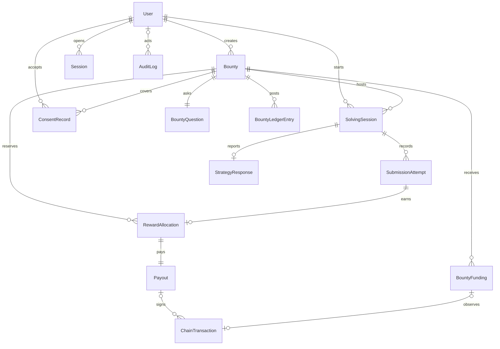

# Database design

Status: **proposed — pending confirmation**. This is not approved DDL. `apps/api/prisma/schema.prisma` represents the entities below. Nothing here has been migrated. No `prisma/migrations` history exists because local PostgreSQL was not accepting connections when the schema was added.

Implementation notes that stay open:

- `StrategyResponse` is specified below and is not a Prisma model. PD-10 is still an open question, so it is omitted from the first schema.
- The `Session` entity is modeled as `AuthSession` and mapped to `auth_sessions`, so the table name stays distinct from `solving_sessions`.
- Primary keys use UUID. The identifier type is still an open choice.
- Balances are derived from `BountyLedgerEntry`. There is no cached balance column.
- Foreign keys use `onDelete: Restrict`. The design does not define cascades.
- `ChainTransaction.commitment` is text. PD-13 has not chosen `confirmed` versus `finalized`.
- The one-active-nonce rule cannot be expressed in Prisma. `apps/api/prisma/manual/partial-indexes.sql` holds the partial unique index and has not been applied.
- `SolvingSession (bountyId, solverId)` unique covers a bounty lookup. `SubmissionAttempt (sessionId, attemptNumber)` unique covers the grading lookup. Separate indexes for those leading columns are not added.

Related: [backend architecture](BACKEND_ARCHITECTURE.md), [blockchain design](BLOCKCHAIN_DESIGN.md), [PRD](../product/PRD.md), PD-01, PD-02, PD-06, PD-12, and PD-19 in the [implementation plan](../development/IMPLEMENTATION_PLAN.md).

Hosting (PD-12): local PostgreSQL for development, Neon for the shared hackathon database. Amounts are lamports stored as integers. Timestamps are UTC.

## Entity relationship



`StrategyResponse` is P1. The relationship is drawn now so the P0 schema does not block it.

`AuthNonce` is not a child of `User`. It is stored by wallet address before a user row exists. A chain transaction belongs to a deposit or to a payout, not both, so those relationships are optional. An audit row may have no actor when the worker posts it.

## Proposed entities

### User

| Column | Notes |
| --- | --- |
| `id` | UUID primary key |
| `walletAddress` | Unique, base58 |
| `role` | `user` or `admin` |
| `createdAt`, `updatedAt` | Server time |

No email, password, name, or user secret key. Admin is also gated by the server allowlist at login (PD-04).

### AuthNonce

| Column | Notes |
| --- | --- |
| `id` | UUID |
| `userWallet` | Wallet the nonce was issued for. A user row may not exist yet |
| `nonce` | Unique |
| `expiresAt` | Proposed TTL 10 minutes |
| `usedAt` | Null until consumed |
| `retiredAt` | Set when a newer nonce is issued |

At most one row per wallet has both `usedAt` and `retiredAt` null. That is the single active authentication nonce. "Authentication challenge" here means the login nonce, not a cognitive bounty.

### Session

| Column | Notes |
| --- | --- |
| `id` | UUID |
| `userId` | Foreign key |
| `refreshTokenHash` | Hash only, under PD-03 |
| `expiresAt` | Refresh expiry. Proposed 7 days |
| `revokedAt` | Set on disconnect |
| `createdAt` | Server time |

This table still fits a server session if PD-03 is replaced by a cookie session. Do not store raw JWTs.

### Bounty

| Column | Notes |
| --- | --- |
| `id` | UUID |
| `creatorId` | Foreign key to User |
| `title`, `description`, `instructions` | Public text |
| `category` | `logic`, `mathematics`, `numerical_patterns`, `ciphers` |
| `rewardLamports` | Integer |
| `maxRewardedSolvers` | Integer |
| `attemptLimit` | Integer |
| `deadline` | UTC |
| `status` | `draft`, `funding_pending`, `active`, `closed` |
| `closeReason` | Null or `creator`, `deadline`, `fully_allocated`, `admin` |
| `publishedAt`, `closedAt` | Nullable |
| `createdAt`, `updatedAt` | Server time |

Principal is not stored as a float. It is `rewardLamports * maxRewardedSolvers`, checked against confirmed deposits.

### BountyQuestion

| Column | Notes |
| --- | --- |
| `id` | UUID |
| `bountyId` | Unique in the MVP, so one question (PD-01) |
| `prompt` | Public |
| `expectedAnswerCiphertext` | AES-256-GCM payload (PD-02) |
| `encryptionKeyId` | Identifies the key version |
| `verificationMethod` | `exact`, `case_insensitive`, `normalized_text`, `numeric_exact` |

The plaintext expected answer is not a column.

### BountyFunding

| Column | Notes |
| --- | --- |
| `id` | UUID |
| `bountyId` | Foreign key |
| `depositReference` | Unique. Matches the memo (PD-18) |
| `expectedLamports` | Principal required |
| `observedLamports` | Nullable until confirmed |
| `chainTransactionId` | Nullable until a signature is stored |
| `status` | `pending`, `confirmed`, `rejected` |
| `createdAt`, `confirmedAt` | Server time |

### BountyLedgerEntry

Append-only. Balances are sums of entries, computed inside the locked bounty transaction. Do not update an entry in place.

| Column | Notes |
| --- | --- |
| `id` | UUID |
| `bountyId` | Foreign key |
| `entryType` | `deposit`, `reserve`, `settle`, `release`, `refund` |
| `amountLamports` | Positive integer |
| `payoutId` | Nullable |
| `fundingId` | Nullable |
| `chainTransactionId` | Nullable |
| `createdAt` | Server time |

Bucket effect:

| Entry | Bucket change |
| --- | --- |
| `deposit` | `funded` and `refundable` increase |
| `reserve` | `refundable` decreases, `reserved` increases |
| `settle` | `reserved` decreases, `paid` increases |
| `release` | `reserved` decreases, `refundable` increases |
| `refund` | `refundable` decreases, `refunded` increases |

Identity after every committed posting:

```text
funded = reserved + paid + refundable + refunded
```

`refunded` is the sum of `refund` entries. It is part of PD-06 so a later creator refund does not break the four product buckets `funded`, `reserved`, `paid`, and `refundable`.

### ConsentRecord

| Column | Notes |
| --- | --- |
| `id` | UUID |
| `userId`, `bountyId` | Unique together |
| `policyVersion` | Proposed value `research-consent-v1` |
| `acceptedAt` | Server time |

No IP address column (PRIV-003).

### SolvingSession

| Column | Notes |
| --- | --- |
| `id` | UUID |
| `bountyId`, `solverId` | Unique together |
| `consentId` | Foreign key |
| `startedAt` | Server time. Not client time |
| `status` | `active`, `completed` |
| `createdAt` | Server time |

One session per solver per bounty. Status becomes `completed` when an allocation is created, when a correct attempt is stored as capacity-ineligible, or when the attempt limit is exhausted.

### SubmissionAttempt

| Column | Notes |
| --- | --- |
| `id` | UUID |
| `sessionId` | Foreign key |
| `attemptNumber` | Unique with `sessionId`, starting at 1 |
| `submittedAnswer` | Research text. See sensitivity below |
| `isCorrect` | Server decision |
| `ineligibilityReason` | Null, `pool_exhausted`, or `insufficient_refundable` |
| `submittedAt` | Server time |

PD-19 (**proposed — pending confirmation**): submitted answers are stored for the owning creator's private review and are omitted from public APIs. They are not encrypted in the MVP. The expected answer is encrypted. Those are different columns and different rules.

### StrategyResponse

P1. One row per solving session.

| Column | Notes |
| --- | --- |
| `id` | UUID |
| `sessionId` | Unique |
| `strategy` | Nullable enum from PD-10 |
| `explanation` | Nullable text, proposed cap 2_000 characters |

### RewardAllocation

| Column | Notes |
| --- | --- |
| `id` | UUID |
| `bountyId`, `solverId` | Unique together |
| `attemptId` | Unique. The attempt that earned it |
| `amountLamports` | Copied from the bounty reward |
| `status` | `reserved`, `paid`, `released` |
| `createdAt` | Server time |

### Payout

One payout row per allocation. Retries update this row. They do not insert a second payout.

| Column | Notes |
| --- | --- |
| `id` | UUID |
| `allocationId` | Unique |
| `idempotencyKey` | Unique. Proposed `payout:<bountyId>:<walletAddress>` |
| `status` | `pending`, `submitted`, `confirmed`, `failed`, `retryable` |
| `sendCount` | Integer |
| `lastError` | Sanitized text. No secrets |
| `createdAt`, `updatedAt` | Server time |

### ChainTransaction

| Column | Notes |
| --- | --- |
| `id` | UUID |
| `signature` | Unique |
| `kind` | `deposit`, `payout`, `refund` |
| `amountLamports` | Observed amount |
| `sourceAddress`, `destinationAddress` | Base58 |
| `commitment` | Proposed required value `confirmed` (PD-13) |
| `confirmedAt` | Nullable |
| `createdAt` | Server time |

A payout keeps failed signatures here too, linked by a `payoutId` foreign key, so a retry can prove it did not forget an earlier signature.

### AuditLog

| Column | Notes |
| --- | --- |
| `id` | UUID |
| `actorUserId` | Nullable for worker postings |
| `action` | Stable verb |
| `entityType`, `entityId` | Target |
| `metadata` | JSON without answers, tokens, or secrets |
| `createdAt` | Server time |

Required actions are listed in NFR-017.

## Constraints that protect money and secrecy

- One user per wallet address.
- One active authentication nonce per wallet.
- One question per bounty in the MVP (`bountyId` unique on `BountyQuestion`).
- One consent row per user per bounty.
- One solving session per solver per bounty.
- Attempt numbers unique inside a session and not above `attemptLimit`.
- One reward allocation per bounty per solver.
- One payout per allocation.
- One ledger posting per confirmed chain signature and entry type.
- Public query projections must not select `expectedAnswerCiphertext`.

## Sensitive data

| Data | Handling |
| --- | --- |
| Expected answer | Ciphertext only (PD-02). Key is `ANSWER_ENCRYPTION_KEY`, distinct from the treasury key |
| Submitted answer | Access-controlled plaintext (PD-19). Owner private view and the solver's own history |
| Explanation | Same audience as the submitted answer. P1 |
| Refresh token | Hash at rest |
| Treasury secret | Not a column. Environment only (PD-15) |
| Wallet address | Stored for auth and payment. Omitted from default analytics and CSV |
| Chain signature | Public. Safe to store and show |

Proposed encryption detail for PD-02: AES-256-GCM via Node `crypto`, with a random nonce stored beside the ciphertext and a key id for later rotation. Decryption is allowed only in verification and the owner private read.

## Indexes

Proposed indexes beyond the unique keys above:

- `Bounty (status, deadline)` for the marketplace.
- `Bounty (creatorId, createdAt)` for the dashboard.
- `SolvingSession (bountyId)` for analytics.
- `SubmissionAttempt (sessionId, attemptNumber)` for grading and metrics.
- `Payout (status)` for the worker.
- `ChainTransaction (signature)` unique lookup.
- `AuditLog (entityType, entityId, createdAt)`.

## Unapproved choices

The following stay open until Phase 2 schema review, even though the tables above are the working proposal:

- UUID versus another identifier type.
- Exact Prisma enum names.
- Whether balances are only derived from `BountyLedgerEntry` or also cached on `Bounty` inside the same transaction. The design prefers derivation plus the bounty row lock. A cache column is optional and must not be writable except by the ledger transaction.
- Whether `StrategyResponse` ships in the first migration or the P1 migration. The table is specified now so the model does not need a new parent later.
