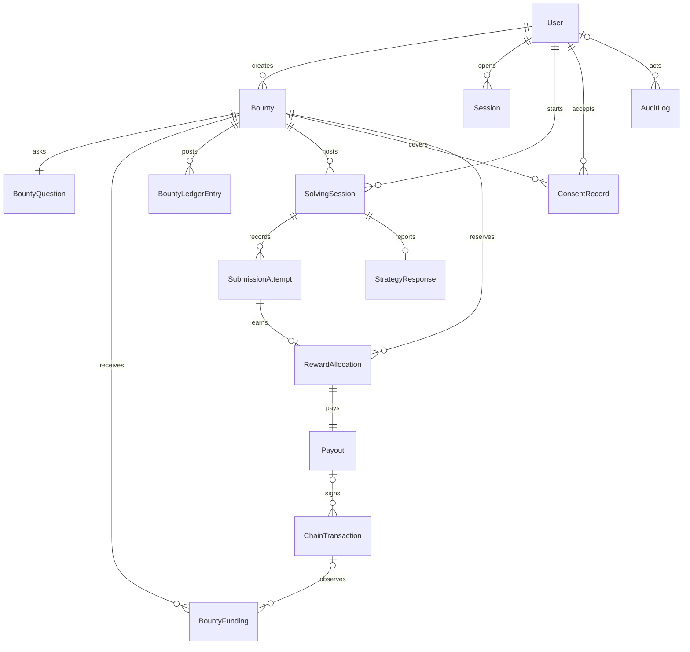

# Database design

Status: **direction approved for the MVP**. `apps/api/prisma/schema.prisma` has 14 models. The initial migration `20261107173154_initial_schema` is applied on the Neon development database `neondb` in `ap-southeast-1`. It is not a production migration.

Four layers stay separate:

| Layer | Meaning in this document |
| --- | --- |
| Prisma schema | 14 models. `FundingPurpose`, the two funding uniqueness rules, and the unique `refreshTokenHash` index are declared in `schema.prisma`. Not migrated |
| Applied DDL | None. The partial nonce index is in the unapplied initial migration and in `apps/api/prisma/manual/partial-indexes.sql` |
| Accepted decisions | ADR-001 through ADR-011, including the reward-pool identity and commission outside `funded` |
| Unresolved details | Listed under Deferred decisions. They block funding or migration only where that section says so |

Approved direction:

- UUID primary keys. PostgreSQL. No extra reward-pool bucket and no platform revenue table.
- Server-side sessions. The hash column stays `refreshTokenHash`. It is unique in `schema.prisma`. Not migrated.
- One active authentication nonce per wallet. The partial unique index is in the unapplied initial migration. Prisma cannot declare it, so it is also kept in `apps/api/prisma/manual/partial-indexes.sql`.
- `ConsentRecord.policyVersion` stays a string. The version text is not accepted.
- Balances stay sums of `BountyLedgerEntry`. Foreign keys stay `onDelete: Restrict`.
- `ChainTransaction.commitment` stays text. [ADR-005](../decisions/ADR-005-solana-confirmed-commitment.md) requires the value `confirmed` before funding or payout completion.

Related: [backend architecture](BACKEND_ARCHITECTURE.md), [blockchain design](BLOCKCHAIN_DESIGN.md), [PRD](../product/PRD.md), PD-01, PD-02, PD-06, PD-12, and PD-19 in the [implementation plan](../development/IMPLEMENTATION_PLAN.md).

Hosting (PD-12): local PostgreSQL for development, Neon for the shared hackathon database. Amounts are lamports stored as integers. Timestamps are UTC.

## Entity relationship



`StrategyResponse` is not in the MVP. The relationship is drawn so a later table can attach to `SolvingSession`. No migration adds it now.

`AuthNonce` is not a child of `User`. It is stored by wallet address before a user row exists. A chain transaction belongs to a deposit or to a payout, not both, so those relationships are optional. An audit row may have no actor when the worker posts it.

## Proposed entities

### User

| Column | Notes |
| --- | --- |
| `id` | UUID primary key |
| `walletAddress` | Unique, base58 |
| `role` | `user` or `admin` |
| `createdAt`, `updatedAt` | Server time |

No email, password, name, or user secret key. Admin is also gated by the server allowlist at login (PD-04).

### AuthNonce

| Column | Notes |
| --- | --- |
| `id` | UUID |
| `userWallet` | Wallet the nonce was issued for. A user row may not exist yet |
| `nonce` | Unique |
| `expiresAt` | Proposed TTL 10 minutes |
| `usedAt` | Null until consumed |
| `retiredAt` | Set when a newer nonce is issued |

At most one row per wallet has both `usedAt` and `retiredAt` null. That row is the single active authentication nonce. "Authentication challenge" here means the login nonce, not a cognitive bounty. No second nonce model is added.

A used, retired, or expired nonce must not permanently block a new nonce. The partial index only forbids two rows that are both unused and not retired. An expired row that is still unused and not retired would block issuance, so the application retires or consumes the previous nonce before it inserts the next one. The 10-minute lifetime remains proposed. The first migration includes `auth_nonces_one_active_per_wallet`.

### Session

| Column | Notes |
| --- | --- |
| `id` | UUID |
| `userId` | Foreign key |
| `refreshTokenHash` | Hash of the session token ([ADR-003](../decisions/ADR-003-postgresql-server-side-sessions.md)). The raw token is not stored. The column name is unchanged until a later schema change |
| `expiresAt` | Session expiry. ADR-003 does not set the lifetime |
| `revokedAt` | Set on logout, disconnect, or account-wide revocation |
| `createdAt` | Server time |

ADR-003 uses this table for the server session. Do not store the raw session token or a JWT.

### Bounty

| Column | Notes |
| --- | --- |
| `id` | UUID |
| `creatorId` | Foreign key to User |
| `title`, `description`, `instructions` | Public text |
| `category` | `logic`, `mathematics`, `numerical_patterns`, `ciphers` |
| `rewardLamports` | Integer |
| `maxRewardedSolvers` | Integer |
| `attemptLimit` | Integer |
| `deadline` | UTC |
| `status` | `draft`, `funding_pending`, `active`, `closed` |
| `closeReason` | Null or `creator`, `deadline`, `fully_allocated`, `admin` |
| `publishedAt`, `closedAt` | Nullable |
| `createdAt`, `updatedAt` | Server time |

Principal is not stored as a float. Expected reward-pool principal is `rewardLamports * maxRewardedSolvers`, computed in integers. It is not a second column. Expected commission is the separate integer described under BountyFunding. Total creator payment is those two integers added together. That total is not a ledger bucket and is not `funded`.

### BountyQuestion

| Column | Notes |
| --- | --- |
| `id` | UUID |
| `bountyId` | Unique in the MVP, so one question (PD-01) |
| `prompt` | Public |
| `expectedAnswerCiphertext` | AES-256-GCM payload (PD-02) |
| `encryptionKeyId` | Identifies the key version |
| `verificationMethod` | `exact`, `case_insensitive`, `normalized_text`, `numeric_exact` |

The plaintext expected answer is not a column.

### BountyFunding

The model holds two logical funding records, distinguished by `purpose`, not a new table.

`purpose` is the `FundingPurpose` enum in `schema.prisma`: `reward_pool` or `commission`. It is not migrated.

| Column | In `schema.prisma`? | Notes |
| --- | --- | --- |
| `id` | Yes | UUID |
| `bountyId` | Yes | Foreign key |
| `purpose` | Yes | `FundingPurpose`: `reward_pool` or `commission` |
| `depositReference` | Yes | Unique. Memo text is still PD-18 |
| `expectedLamports` | Yes | Integer obligation for this record |
| `observedLamports` | Yes | Nullable until that obligation is verified |
| `chainTransactionId` | Yes | Nullable until a signature is stored |
| `status` | Yes | `pending`, `confirmed`, `rejected` |
| `createdAt`, `confirmedAt` | Yes | Server time |

These two records are separate funding obligations. They are not a decision that the creator signs two Solana transactions. One transfer or two remains unresolved. The commission address is unresolved.

| Obligation | `expectedLamports` | Verification | Effect on `funded` |
| --- | --- | --- | --- |
| `reward_pool` | `rewardLamports * maxRewardedSolvers` | Its own confirmed observation must cover this integer | One `deposit` increases `funded` and `refundable` |
| `commission` | `floor(rewardPoolLamports * 5 / 100)` | Its own confirmed observation must cover this integer | None. Confirmation does not increase `funded` |

Both obligations are verified independently. The bounty stays inactive until both records are `confirmed`. Total creator payment is the sum of the two `expectedLamports` values. That sum is not a ledger bucket.

Constraints declared in `schema.prisma`, not migrated:

- Unique `(bountyId, purpose)`, so one pool obligation and one commission obligation.
- Unique `(chainTransactionId, purpose)` where a signature is present. This replaces unique `chainTransactionId` alone. Two signatures can be stored. One signature can be cited by both records if a later decision uses a single transfer. The constraint does not choose either shape. PostgreSQL still allows several rows whose `chainTransactionId` is null.

#### Commission rounding

Commission is 5% of the original reward pool ([ADR-007](../decisions/ADR-007-company-platform-commission.md)). The obligation is an integer lamport amount:

```text
commissionLamports = floor(rewardPoolLamports * 5 / 100)
```

Calculate that with integer arithmetic. Do not use floating-point arithmetic. A fractional lamport is rounded down. The commission is never rounded up. `floor(1_000_000_001 * 5 / 100)` is 50_000_000. The `commission` funding record stores that integer in `expectedLamports`. Confirmation of that record still does not increase `funded`.

The commission address, and whether one Solana transfer or two pays the two obligations, remain unresolved.

### BountyLedgerEntry

Append-only. Balances are sums of entries, computed inside the locked bounty transaction. Do not update an entry in place.

| Column | Notes |
| --- | --- |
| `id` | UUID |
| `bountyId` | Foreign key |
| `entryType` | `deposit`, `reserve`, `settle`, `release`, `refund` |
| `amountLamports` | Positive integer. The unapplied initial migration checks `amount_lamports > 0`. That check is not in `schema.prisma` |
| `payoutId` | Nullable |
| `fundingId` | Nullable |
| `chainTransactionId` | Nullable |
| `createdAt` | Server time |

Bucket effect:

| Entry | Bucket change |
| --- | --- |
| `deposit` | `funded` and `refundable` increase |
| `reserve` | `refundable` decreases, `reserved` increases |
| `settle` | `reserved` decreases, `paid` increases |
| `release` | `reserved` decreases, `refundable` increases |
| `refund` | `refundable` decreases, `refunded` increases |

Identity after every committed posting:

```text
funded = reserved + paid + refundable + refunded
```

`refunded` is the sum of `refund` entries and remains part of the identity. `refundable` is the unallocated balance. The name does not entitle the creator to a refund. A `deposit` entry is posted only for a confirmed `reward_pool` funding row. A confirmed `commission` row is not a `deposit`.

[ADR-008](../decisions/ADR-008-unused-reward-pool-retention.md) does not post retained unused principal as `paid` or as `refunded`. After the deadline or the participant cap, that unallocated remainder is platform revenue and stays in `refundable`. [ADR-011](../decisions/ADR-011-separate-platform-revenue-ledger.md) classifies that same balance. Reports must not add the classification on top of `refundable`, `funded`, or the treasury balance. There is no retained bucket and no revenue table. No new entry type is added. Cancelled, never-activated, failed-funding, creator-close, and admin-close balances remain unspecified. The `refund` entry type stays in the enum and is not used for normal closure.

### ConsentRecord

| Column | Notes |
| --- | --- |
| `id` | UUID |
| `userId`, `bountyId` | Unique together |
| `policyVersion` | String. Not an enum. The version text is not accepted yet |
| `acceptedAt` | Server time |

No IP address column (PRIV-003).

### SolvingSession

| Column | Notes |
| --- | --- |
| `id` | UUID |
| `bountyId`, `solverId` | Unique together |
| `consentId` | Foreign key |
| `startedAt` | Server time. Not client time |
| `status` | `active`, `completed` |
| `createdAt` | Server time |

One session per solver per bounty. Status becomes `completed` when an allocation is created, when a correct attempt is stored as capacity-ineligible, or when the attempt limit is exhausted.

### SubmissionAttempt

| Column | Notes |
| --- | --- |
| `id` | UUID |
| `sessionId` | Foreign key |
| `attemptNumber` | Unique with `sessionId`, starting at 1 |
| `submittedAnswer` | Research text. See sensitivity below |
| `isCorrect` | Server decision |
| `ineligibilityReason` | Null, `pool_exhausted`, or `insufficient_refundable` |
| `submittedAt` | Server time |

PD-19 (**proposed — pending confirmation**): submitted answers are stored for verification and the solver's own history. They are omitted from public APIs and from creator and administrator analytics ([ADR-010](../decisions/ADR-010-role-based-analytics-visibility.md)). They are not encrypted in the MVP. The expected answer is encrypted. Those are different columns and different rules. This decision adds no column.

### StrategyResponse

Not in the MVP ([ADR-009](../decisions/ADR-009-minimal-research-analytics.md)). Not a Prisma model. One row per solving session if a later version collects it.

| Column | Notes |
| --- | --- |
| `id` | UUID |
| `sessionId` | Unique |
| `strategy` | Nullable enum from PD-10 |
| `explanation` | Nullable text, proposed cap 2_000 characters |

### RewardAllocation

| Column | Notes |
| --- | --- |
| `id` | UUID |
| `bountyId`, `solverId` | Unique together |
| `attemptId` | Unique. The attempt that earned it |
| `amountLamports` | Copied from the bounty reward. The unapplied initial migration checks `amount_lamports > 0`. That check is not in `schema.prisma` |
| `status` | `reserved`, `paid`, `released` |
| `createdAt` | Server time |

### Payout

One payout row per allocation. Retries update this row. They do not insert a second payout.

| Column | Notes |
| --- | --- |
| `id` | UUID |
| `allocationId` | Unique |
| `idempotencyKey` | Unique. Proposed `payout:<bountyId>:<walletAddress>` |
| `status` | `pending`, `submitted`, `confirmed`, `failed`, `retryable` |
| `sendCount` | Integer |
| `lastError` | Sanitized text. No secrets |
| `createdAt`, `updatedAt` | Server time |

### ChainTransaction

| Column | Notes |
| --- | --- |
| `id` | UUID |
| `signature` | Unique |
| `kind` | `deposit`, `payout`, `refund` |
| `amountLamports` | Observed amount |
| `sourceAddress`, `destinationAddress` | Base58 |
| `commitment` | Required value `confirmed` ([ADR-005](../decisions/ADR-005-solana-confirmed-commitment.md)). Stored as text. No migration in that decision |
| `confirmedAt` | Nullable |
| `createdAt` | Server time |

A payout keeps failed signatures here too, linked by a `payoutId` foreign key, so a retry can prove it did not forget an earlier signature.

### AuditLog

| Column | Notes |
| --- | --- |
| `id` | UUID |
| `actorUserId` | Nullable for worker postings |
| `action` | Stable verb |
| `entityType`, `entityId` | Target |
| `metadata` | JSON without answers, tokens, or secrets |
| `createdAt` | Server time |

Required actions are listed in NFR-017.

## Constraints that protect money and secrecy

- One user per wallet address.
- One active authentication nonce per wallet, through the partial unique index. Not applied.
- Unique `AuthSession.refreshTokenHash`. Declared in `schema.prisma`. Not migrated.
- One question per bounty in the MVP (`bountyId` unique on `BountyQuestion`).
- One consent row per user per bounty. A solving session requires that row.
- One solving session per solver per bounty.
- Attempt numbers unique inside a session and not above `attemptLimit`.
- One reward allocation per bounty per solver.
- One payout per allocation.
- One pool funding row and one commission funding row per bounty. Unique `(bountyId, purpose)` in `schema.prisma`. Not migrated.
- A `deposit` ledger entry comes only from the confirmed pool funding row.
- One ledger posting per confirmed chain signature and entry type.
- Public and analytics queries must not select `expectedAnswerCiphertext`, `submittedAnswer`, or solver wallet addresses ([ADR-010](../decisions/ADR-010-role-based-analytics-visibility.md)).

## Sensitive data

| Data | Handling |
| --- | --- |
| Expected answer | Ciphertext only (PD-02). Key is `ANSWER_ENCRYPTION_KEY`, distinct from the treasury key |
| Submitted answer | Access-controlled plaintext (PD-19). The solver's own history. Not returned by creator or administrator analytics ([ADR-010](../decisions/ADR-010-role-based-analytics-visibility.md)) |
| Explanation | Not collected in the MVP ([ADR-009](../decisions/ADR-009-minimal-research-analytics.md)). A later version would use the same audience as the submitted answer |
| Refresh token | Hash at rest |
| Treasury secret | Not a column. Backend environment only ([ADR-006](../decisions/ADR-006-devnet-treasury-private-key-storage.md)) |
| Wallet address | Stored for auth and payment. Omitted from analytics for creators and administrators ([ADR-010](../decisions/ADR-010-role-based-analytics-visibility.md)). Research export is not in the MVP |
| Chain signature | Public. Safe to store and show |

Proposed encryption detail for PD-02: AES-256-GCM via Node `crypto`, with a random nonce stored beside the ciphertext and a key id for later rotation. Decryption is allowed only in verification and the owner private read.

## Indexes

Already declared on the unmigrated schema, or implied by a unique key:

- `Bounty (status, deadline)` for the marketplace.
- `Bounty (creatorId, createdAt)` for the creator's own bounties.
- `Payout (status)` for the worker.
- `ChainTransaction (signature)` unique lookup.
- `AuditLog (entityType, entityId, createdAt)`.
- Unique keys listed in the constraints section.

Unique index on `AuthSession.refreshTokenHash` for session lookup. Declared in `schema.prisma`. Not migrated.

Do not add a separate index on `SolvingSession.bountyId` or `SubmissionAttempt.sessionId`. The unique `(bountyId, solverId)` and unique `(sessionId, attemptNumber)` keys already serve those lookups.

The partial nonce index is in the unapplied initial migration. The same statement stays in `apps/api/prisma/manual/partial-indexes.sql`.

## Transaction boundaries

These are application transactions. They do not add tables.

| Boundary | What commits together |
| --- | --- |
| E1 reservation | Lock the bounty row. Insert the attempt, the one allocation, the `reserve` ledger entry, and the `pending` payout, or roll all of them back. Move lamports from `refundable` to `reserved`. Eligibility rule E1 is unchanged |
| Payout send | After that commit. Sign only when no unconfirmed or confirmed signature already exists for the payout. Do not hold the database transaction open across RPC |
| Settlement | One `settle` entry moves `reserved` to `paid` after [ADR-005](../decisions/ADR-005-solana-confirmed-commitment.md) `confirmed` and the detail checks. Repeating the signature does not post a second `settle` |
| Release | A permanently failed payout posts `release`, moving `reserved` back to `refundable`, on the same payout row |
| Pool deposit | A confirmed `reward_pool` funding row posts one `deposit`. A confirmed `commission` row posts none |

Normal closure does not post a ledger entry that removes retained principal from `refundable`.

## Analytics queries

ADR-009 metrics are queries, not stored aggregates.

- Participants: count of `SolvingSession` rows for the bounty.
- Correct and incorrect counts: count of `SubmissionAttempt` rows by `isCorrect`.
- Attempt count: count of those attempts.
- Average completion time: mean of first correct `submittedAt` minus session `startedAt`, over sessions that have a correct attempt. Both timestamps are server columns.
- Accuracy: correct attempts divided by all attempts.

A creator query filters `Bounty.creatorId` to the session user. An administrator query may group the same figures by bounty or creator. Neither query selects solver wallet addresses or `submittedAnswer`. Consent is the `ConsentRecord` row required before the session insert. Wallet login does not write that row.

## Deferred decisions

Unresolved. This document does not decide them:

- Exceptional termination balances: cancelled, never active, failed or incomplete funding, creator close, and admin close.
- Commission treatment in those endings.
- Commission receiving address.
- Whether the creator signs one Solana transfer or two. The two funding records are obligations, not that choice.
- Fee buffer (PD-07). It is not a ledger bucket.
- Session lifetime and the CSRF mechanism. No CSRF column. The API uses an 8-hour lifetime and a logout CSRF cookie as working defaults. Neither is an accepted ADR decision. Nonce lifetime of 10 minutes is still proposed.
- A physical revenue-recognition row. ADR-011 does not require one.
- Renaming `refreshTokenHash`.
- The consent policy version string.
- Submitted-answer encryption (PD-19). The plaintext column stays as proposed.

## Prerequisites

Before the first migration:

- Keep the 14 existing models. Do not add a revenue table or a ledger entry type.
- The initial migration already includes `auth_nonces_one_active_per_wallet`. Do not add it a second time.
- The same migration checks `amount_lamports > 0` on `bounty_ledger_entries` and `reward_allocations` (SEC-H6). Those checks are not in `schema.prisma`. A later Prisma diff must not drop them.
- Carry the session-hash unique index and the `BountyFunding.purpose` constraints already declared in `schema.prisma`.
- Do not apply the migration to a shared or production database from this document.

Before funding implementation:

- Do not choose a commission address or a one-transfer versus two-transfer design inside the schema. Verification still treats the pool obligation and the commission obligation independently.
- Set the commission obligation with `floor(rewardPoolLamports * 5 / 100)` in integer lamports ([ADR-007](../decisions/ADR-007-company-platform-commission.md)). Do not use floating-point arithmetic.
- Post `deposit` only for the confirmed `reward_pool` record.

## Unapproved choices

The following are still not accepted as DDL:

- Applying the schema. `schema.prisma` is updated and still unmigrated.
- `StrategyResponse` is not in the MVP ([ADR-009](../decisions/ADR-009-minimal-research-analytics.md)). It is not a Prisma model and is not part of the first migration.
