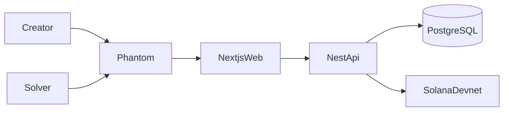
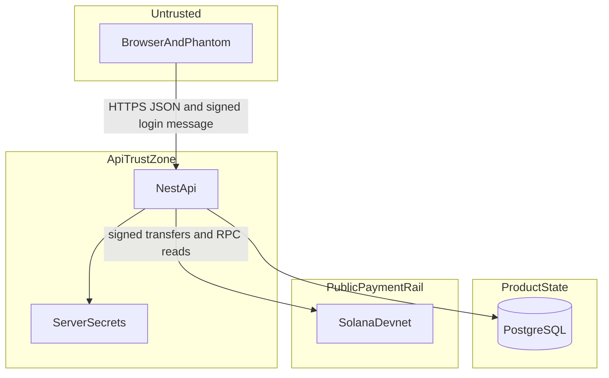
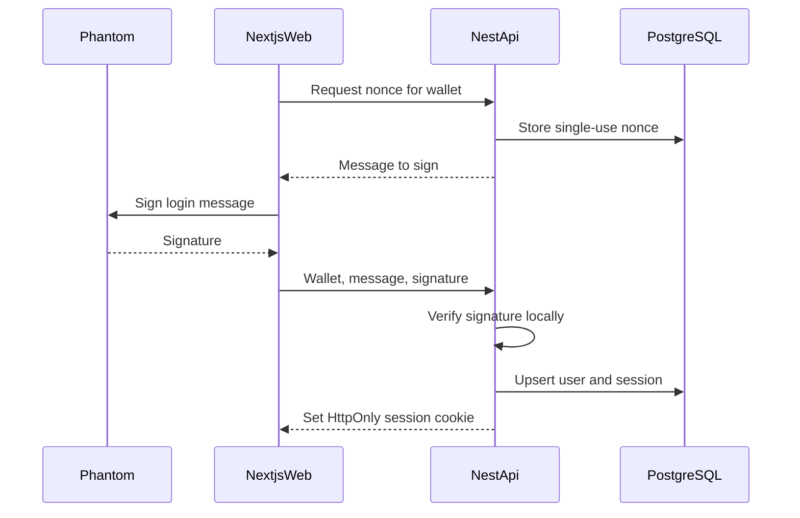
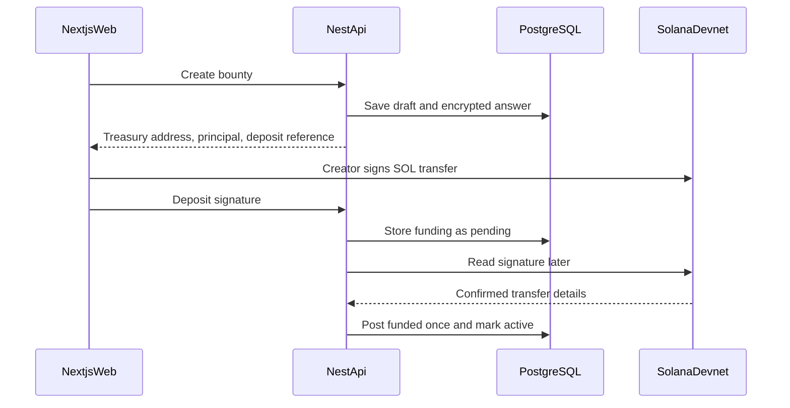
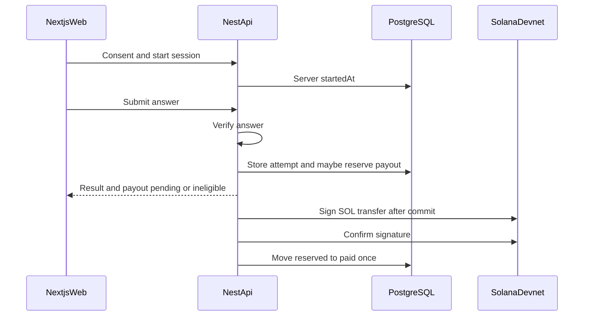
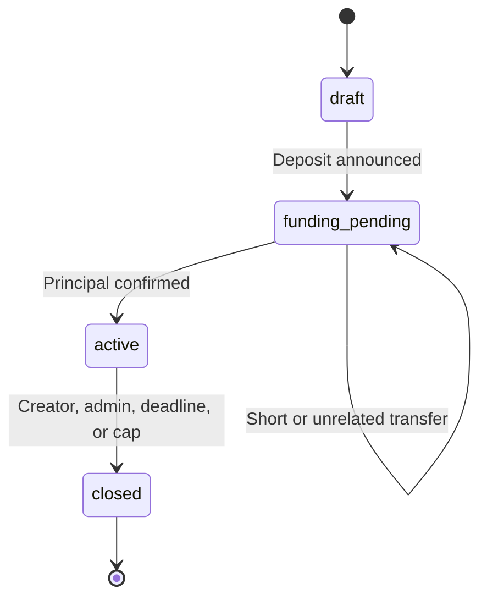

# System architecture

Status: design intent for the hackathon MVP. No process in this document is running. Confirmed decisions are `CD-*`. Items marked **proposed — pending confirmation** use `PD-*` from the [implementation plan](../development/IMPLEMENTATION_PLAN.md).

Related: [PRD](../product/PRD.md), [backend architecture](BACKEND_ARCHITECTURE.md), [database design](DATABASE_DESIGN.md), [blockchain design](BLOCKCHAIN_DESIGN.md), [ADR-001](../decisions/ADR-001-modular-monolith.md), [ADR-002](../decisions/ADR-002-custodial-devnet-treasury.md).

## Purpose

SolversBounty is one web client and one API process, backed by PostgreSQL and Solana Devnet. The API is the source of product truth. The chain is the payment rail and the evidence for deposits and payouts.

The treasury that holds creator principal is custodial (CD-11). This architecture does not use a custom Solana program (CD-05).

## System context



Intended deployables, not created:

| Piece | Responsibility |
| --- | --- |
| `apps/web` | Pages, wallet connection, forms, display of server state |
| `apps/api` | Auth, authorization, ledger, verification, payout orchestration |
| `packages/shared` | Zod contracts and shared types (PD-17) |
| PostgreSQL | Users, bounties, sessions, attempts, ledger, payouts |
| Solana Devnet | SOL transfers the API verifies or signs |

Local development uses a local Postgres. The shared hackathon database is Neon (PD-12).

## Trust boundaries



| Boundary | Trust | Rule |
| --- | --- | --- |
| Browser | Untrusted | Presentation and wallet signing only. It does not decide correctness, time, eligibility, or payment. |
| Phantom | Holds the user key | The user key never crosses into the API. Login messages are not SOL transfers. |
| API | Trusted for the demo | Auth, authorization, validation, ledger, verification, payout orchestration. |
| Server secrets | Trusted storage | Treasury key ([ADR-006](../decisions/ADR-006-devnet-treasury-private-key-storage.md)) and answer-encryption key (PD-02). Neither is a database column. |
| PostgreSQL | Product source of truth | On-chain transfers do not replace the ledger. They advance it after checks. |
| Solana Devnet | Public rail | Amounts and addresses are observable. Success commitment is `confirmed` ([ADR-005](../decisions/ADR-005-solana-confirmed-commitment.md)), which is not mainnet finality. |

Creator private fields and solver research fields use different API routes from public bounty DTOs. Public DTOs omit the expected answer, its ciphertext, submitted answers, explanations, and wallet-level research rows. Creator and administrator analytics also omit solver wallet addresses and individual research records ([ADR-010](../decisions/ADR-010-role-based-analytics-visibility.md)).

## Application boundaries

The web app may:

- Connect Phantom and request a signature over the login message.
- Call the API with the session credential.
- Render bounty status, attempt results, analytics, and payout status returned by the API.

The web app must not:

- Store or receive the expected answer except on the authenticated owner view.
- Store the treasury secret.
- Mark an attempt correct, choose a reward amount, or submit a payout transaction.
- Treat its own clock as the session clock.

The API may:

- Verify login signatures locally, without RPC.
- Encrypt and decrypt expected answers inside the owner view and the verification path.
- Reserve rewards under eligibility rule E1.
- Sign treasury transfers after the matching database transaction commits.

The API must not:

- Accept client `isCorrect`, client timestamps, or client payout amounts as facts.
- Sign a second payout while an earlier signature for that allocation is unresolved or confirmed.
- Log answers, session tokens, cookies, or secret keys.

## Data flow

### Authentication



Session shape is [ADR-003](../decisions/ADR-003-postgresql-server-side-sessions.md): the API stores a hash of the session token and sets the raw token in an HttpOnly cookie. A reused or expired nonce stops the sequence before a session is written. The browser signs the exact message from `POST /auth/nonce`. Wallet disconnect does not revoke the session. Logout does.

### Creator funding



The HTTP create and the HTTP "I sent this signature" calls return without waiting for cluster confirmation (PD-16). Activation happens in the confirmation worker.

### Solve and pay



Payout timing is [ADR-004](../decisions/ADR-004-immediate-individual-solver-payouts.md): one individual transfer after reservation, with confirmation handled afterward. Payouts are not implemented. Confirmation commitment is [ADR-005](../decisions/ADR-005-solana-confirmed-commitment.md).

Eligibility rule E1, verbatim:

A reward allocation is created only inside one database transaction when the submission attempt is verified correct, the attempt belongs to the authenticated solver's solving session, a consent record exists, the attempt number is within the bounty attempt limit, the bounty is active, the server time is at or before the deadline, that solver has no allocation on that bounty, the number of allocations is below max rewarded solvers, and refundable lamports are at least the reward. The same transaction moves the reward from refundable to reserved and inserts one payout in `pending`. The chain transfer happens after the transaction commits. A correct attempt that fails only the capacity checks (allocation cap or refundable balance) is stored with an ineligibility reason and creates no payout. Requests that fail consent, ownership, attempt limit, bounty activity, or deadline are rejected and store no attempt.

### Analytics

Analytics reads stored sessions and attempts for one bounty owned by the caller. It does not call the chain and does not re-grade answers. Definitions are in [PRD section 5.8](../product/PRD.md).

## Bounty state

Stored status is `draft`, `funding_pending`, `active`, or `closed`. Close reason is `creator`, `deadline`, `fully_allocated`, or `admin`. The UI may label those reasons Closed, Expired, and Fully allocated.



A bounty at the cap uses `closed` plus `fully_allocated`. It is not a fifth status.

## Ledger identity

```text
funded = reserved + paid + refundable + refunded
```

`funded` is cumulative confirmed reward-pool deposits. It does not include the ADR-007 commission. `reserved` is held for an unconfirmed solver payout. `paid` is confirmed solver payouts. `refundable` is unallocated principal. After the deadline or the participant cap, [ADR-008](../decisions/ADR-008-unused-reward-pool-retention.md) retains that remainder as platform revenue and does not add it to `paid`. `refunded` stays in the identity. The retention posting is not specified. Details: [blockchain design](BLOCKCHAIN_DESIGN.md).

## Security boundaries

- Public routes: marketplace reads and health. They return no private research rows.
- Authenticated routes: session required.
- Owner routes: bounty private detail, own-bounty analytics, distribution, and close. A creator close does not apply ADR-008 retention. Own-bounty analytics are aggregates and omit solver wallets ([ADR-010](../decisions/ADR-010-role-based-analytics-visibility.md)).
- Admin routes: operational reads, admin close, and platform aggregated analytics. Role comes from the server allowlist (PD-04). Analytics responses still omit individual solver research records and solver wallet addresses. Operational access does not grant those records.
- Worker routes: none. The confirmation loop is in-process, not a public webhook, unless a later ADR adds one.

Rate limits sit in front of nonce issuance and submissions (PD-20, NFR-008).

## What this architecture refuses

- A microservice per module. See [ADR-001](../decisions/ADR-001-modular-monolith.md).
- A browser-held treasury key.
- Trustless or program-owned escrow in the MVP. See [ADR-002](../decisions/ADR-002-custodial-devnet-treasury.md).
- A notifications service. Status is read from product rows (PRD reconciliation C4).
- Mainnet or production custody.
