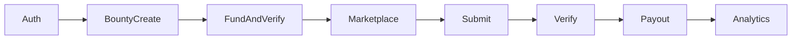

# Implementation plan

Status: Phase 5 security review is written. Proposed Prisma models exist and have not been migrated. No product feature in this plan is implemented. PD-03 is superseded by [ADR-003](../decisions/ADR-003-postgresql-server-side-sessions.md). PD-05 is superseded by [ADR-004](../decisions/ADR-004-immediate-individual-solver-payouts.md). PD-13 is superseded by [ADR-005](../decisions/ADR-005-solana-confirmed-commitment.md). PD-15 is superseded by [ADR-006](../decisions/ADR-006-devnet-treasury-private-key-storage.md). CD-12 is superseded by [ADR-007](../decisions/ADR-007-company-platform-commission.md). The other open questions below are unchanged.

Related: [PRD](../product/PRD.md), [requirements](../product/REQUIREMENTS.md), [progress](PROGRESS.md).

The schedule is elapsed team time for a hackathon pair, not 40 hours per person. If the clock runs out, drop P1 before cutting the critical path.

## Critical path

The path is authentication, bounty creation, funding, marketplace, submission, verification, payout, and P0 analytics. Demo acceptance is the story in [user stories](../product/USER_STORIES.md).

## Milestones

| Milestone | Hours | Outcome | Depends on |
| --- | ---: | --- | --- |
| M0 | Done | Documentation foundation | Nothing |
| M1 | 0–4 | Monorepo, web shell, API shell, Prisma wired to local Postgres | M0 confirmed |
| M2 | 4–8 | Wallet login and user upsert | M1 |
| M3 | 8–13 | Creator dashboard and bounty creation | M2 |
| M4 | 13–17 | Devnet deposit verification and activation | M3 |
| M5 | 17–22 | Marketplace and solving session | M4 for a real attempt, M3 for UI against fixtures |
| M6 | 22–26 | Submissions and verification | M5 |
| M7 | 26–31 | Reservation, payout, confirmation | M4 and M6 |
| M8 | 31–34 | P0 analytics | M6. Payout status display also needs M7 |
| M9 | 34–37 | Integration pass and UI tightening | M7 and M8 |
| M10 | 37–40 | Demo script, bug fixes, deployment notes | M9 |

M5 UI can be built with fixture bounties, but a solver cannot complete a real session until M4 marks a bounty active. M7 cannot start before both funding and verification exist.

### M1 — Monorepo

Scaffold `apps/web`, `apps/api`, `packages/shared`, and `packages/typescript-config` with pnpm and Turborepo. Add TypeScript strict mode, Tailwind, shadcn/ui, Nest, Prisma, and the test runners named in the testing strategy. No product rules beyond health checks. Do not claim AUTH or PAY requirements done.

### M2 — Authentication

Cover AUTH-001 through AUTH-011, USER-001, and USER-002. Phantom on the client. Nonce, local signature check, and session on the API.

### M3 — Bounty creation

Cover BOUNTY-001 through BOUNTY-006, BOUNTY-008 through BOUNTY-014, and PRIV-009. The creator can save a bounty and read it back. It stays inactive.

### M4 — Funding

Cover BOUNTY-007, BOUNTY-016, PAY-008, PAY-013, PAY-014, PAY-015, and PAY-017. A confirmed deposit activates one bounty. The UI names the treasury as custodial.

### M5 — Marketplace and workspace

Cover MARKET-001 through MARKET-007, SOLVE-001, SOLVE-002, and SOLVE-008. Consent is stored before the session clock starts.

### M6 — Verification

Cover SOLVE-003 through SOLVE-005, SOLVE-009, and VERIFY-001 through VERIFY-009. Incorrect and correct attempts persist. No payout yet, unless M7 is already in progress.

### M7 — Payouts

Cover PAY-001 through PAY-007, PAY-009, PAY-010, PAY-012, and PAY-016, plus SOLVE-006 and SOLVE-007. Fake gateway tests are mandatory here. One Devnet payout is a demo task, not a unit test.

### M8 — Analytics

Cover the [ADR-009](../decisions/ADR-009-minimal-research-analytics.md) metrics: ANALYTICS-001, ANALYTICS-002, ANALYTICS-003, ANALYTICS-005 (average only), ANALYTICS-006 (attempt count), ANALYTICS-009, ANALYTICS-010, ANALYTICS-013, and ANALYTICS-014. Completion rate, median time, strategy summaries, answer-change history, complex charts, and research export are not MVP work.

### M9 — Hardening

Run the payment-safety list in the testing strategy against the API. Check empty states, a second solver wallet, and a narrow viewport for NFR-018. Fix answer leaks and ledger bugs before visual polish.

### M10 — Demo

Two solver wallets, one incorrect attempt, one confirmed payout, analytics visible, duplicate reward refused. Record the evidence in [PROGRESS.md](PROGRESS.md). Deployment is a documented Devnet target, not a production custody design.

Excluded from the MVP by [ADR-009](../decisions/ADR-009-minimal-research-analytics.md): strategies, explanations, answer-change history, research export, and complex charts. They may be reconsidered later. Admin list, admin close, and Playwright remain later work. Creator refund of unused principal after deadline or full allocation is not a feature ([ADR-008](../decisions/ADR-008-unused-reward-pool-retention.md)).

## Requirement coverage

P0 IDs sit on M2 through M8 as named above. P1 IDs are SOLVE-010, SOLVE-011, PAY-011, ANALYTICS-007, ANALYTICS-008, ANALYTICS-011, ANALYTICS-012, ANALYTICS-015, PRIV-006, ADMIN-001 through ADMIN-004, ADMIN-006, and USER-003. ADMIN-005 is a P0 constraint: do not build a separate admin product while building the path. ADMIN-006 is accepted access in [ADR-010](../decisions/ADR-010-role-based-analytics-visibility.md) and is not implemented.

NFR IDs are satisfied by the milestone that introduces the behavior they name, and they are rechecked at M9.

## Stop rule

When time is short, stop in this order:

1. Playwright, charts, CSV, strategy, explanation, admin screens.
2. Visual polish that does not affect the demo story.
3. Do not drop signature checks, answer secrecy, deposit checks, E1, idempotent payout, or P0 analytics.

## Confirmed decisions

| ID | Decision |
| --- | --- |
| CD-01 | pnpm workspaces, Turborepo, `apps/web`, `apps/api`, `packages/shared` |
| CD-02 | Next.js App Router, Tailwind, shadcn/ui, Zustand, TanStack Query, React Hook Form, Zod |
| CD-03 | NestJS modular monolith |
| CD-04 | PostgreSQL and Prisma |
| CD-05 | Solana Devnet, `@solana/web3.js`, no custom program |
| CD-06 | Sign-In with Solana. Phantom. No email, password, or KYC |
| CD-07 | Pseudonymous identity. Privacy-conscious copy. No anonymity claim |
| CD-08 | Backend decides correctness, time, eligibility, and payouts |
| CD-09 | Public APIs never return the expected answer |
| CD-10 | One equal reward per wallet per bounty, inside funds and cap |
| CD-11 | Custodial Devnet treasury |
| CD-12 | Superseded by [ADR-007](../decisions/ADR-007-company-platform-commission.md). The 0% platform fee is not the MVP rule. |
| CD-13 | Swagger / OpenAPI |
| CD-14 | P0 / P1 / P2 split in the PRD |
| CD-15 | Analytics do not claim to read private thoughts. The MVP records the four observed metrics in [ADR-009](../decisions/ADR-009-minimal-research-analytics.md). Self-report is not in the MVP. |

## Proposal register

Each item is **proposed — pending confirmation**, except a row marked superseded. Phase 2 should follow this register unless a listed open question changes it. Changing a confirmed decision or any item that affects money, privacy, or process shape needs an ADR.

| ID | Proposal |
| --- | --- |
| PD-01 | One question per bounty. `BountyQuestion` remains the child so more questions can be added later. |
| PD-02 | Encrypt the expected answer at rest with AES-256-GCM. Decrypt only to verify or to serve the owner. Key is `ANSWER_ENCRYPTION_KEY`. |
| PD-03 | Superseded by [ADR-003](../decisions/ADR-003-postgresql-server-side-sessions.md). PostgreSQL session, hash stored, raw token in an HttpOnly cookie. The 15-minute JWT and 7-day refresh token are not the session shape. |
| PD-04 | Admin role comes from `ADMIN_WALLET_ALLOWLIST`. Same signature login. No admin product in P0. |
| PD-05 | Superseded by [ADR-004](../decisions/ADR-004-immediate-individual-solver-payouts.md). The first E1 success reserves and sends that solver's reward immediately. No ranking and no creator batch. E1 is unchanged. |
| PD-06 | Ledger buckets are `funded`, `reserved`, `paid`, and `refundable`, plus `refunded` so `funded = reserved + paid + refundable + refunded`. One allocation per bounty and solver. One payout row per allocation, retried in place. |
| PD-07 | Network fees come from a treasury fee buffer, not from bounty principal. |
| PD-08 | Superseded for deadline and full allocation by [ADR-008](../decisions/ADR-008-unused-reward-pool-retention.md). Unallocated principal is platform revenue and is not refunded to the creator. `paid` is not redefined. Cancelled, never-activated, failed-funding, creator-close, and admin-close outcomes remain unspecified. In-flight reserved payouts still follow ADR-004. |
| PD-09 | Store research consent before a solving session. Policy version `research-consent-v1`. |
| PD-10 | Not an MVP requirement ([ADR-009](../decisions/ADR-009-minimal-research-analytics.md)). Strategies and explanations are not collected. A later version may reconsider them. The strategy list is not accepted. |
| PD-11 | P0 verification methods are `exact`, `case_insensitive`, `normalized_text`, and `numeric_exact`. No fuzzy or AI grading. `numeric_exact` has no tolerance. |
| PD-12 | Local PostgreSQL for development. Neon for the shared hackathon database. The database design is not approved DDL. |
| PD-13 | Superseded by [ADR-005](../decisions/ADR-005-solana-confirmed-commitment.md). Funding and payouts complete at `confirmed`, after execution and detail checks. `processed` is not sufficient. `finalized` is not required. |
| PD-14 | Superseded for analytics visibility by [ADR-010](../decisions/ADR-010-role-based-analytics-visibility.md). Creators see aggregates for their own bounties. Administrators see platform aggregates of the ADR-009 metrics, including by bounty and by creator. Neither role sees individual solver research records or solver wallet addresses in analytics. Operational administration is separate and does not grant those records. |
| PD-15 | Superseded by [ADR-006](../decisions/ADR-006-devnet-treasury-private-key-storage.md). `TREASURY_SECRET_KEY` is a backend-only environment secret for the Devnet MVP. It is never committed, logged, stored in the database, or sent to the browser. This is not the Mainnet custody strategy. |
| PD-16 | An in-process worker confirms deposits and payouts. HTTP handlers record intent and return. |
| PD-17 | Zod schemas in `packages/shared` are the request and response contract. OpenAPI is generated from them. |
| PD-18 | Deposit memo `sb:deposit:<bountyId>:<reference>`. Payout memo `sb:payout:<payoutId>`. Refund memo `sb:refund:<bountyId>`. |
| PD-19 | Store submitted answers for verification and the solver's own history. Omit them from public APIs and from creator and administrator analytics ([ADR-010](../decisions/ADR-010-role-based-analytics-visibility.md)). Do not encrypt them in the MVP. |
| PD-20 | Starting rate limits: 10 nonce requests per minute per wallet and 30 submissions per minute per wallet. |
| PD-21 | Overfunding is accepted into `refundable`. Underfunding does not activate the bounty. |

Proposed parameters tied to those IDs:

- Nonce lifetime: 10 minutes remains proposed. ADR-003 does not set the nonce lifetime or the session lifetime.
- Attempt-limit maximum at creation: 10 (BOUNTY-002).
- Explanation length cap: 2_000 characters (PD-10).
- Marketplace page size cap: 50 (NFR-010).
- Demo fee buffer top-up: 0.1 SOL, operational only (PD-07).

Deadline handling: a bounty with `status = active` and `deadline <= now()` is not joinable. The API closes it with reason `deadline` when such a request or list query observes it. Session start and submit both use server time, so a late worker is not required for correctness.

Full allocation: the E1 transaction that takes the last slot also sets `closed` and `fully_allocated`.

## Open questions

PD-03 is answered by [ADR-003](../decisions/ADR-003-postgresql-server-side-sessions.md). PD-05 is answered by [ADR-004](../decisions/ADR-004-immediate-individual-solver-payouts.md). PD-13 is answered by [ADR-005](../decisions/ADR-005-solana-confirmed-commitment.md). PD-15 is answered by [ADR-006](../decisions/ADR-006-devnet-treasury-private-key-storage.md). PD-08 is answered for deadline and full allocation by [ADR-008](../decisions/ADR-008-unused-reward-pool-retention.md). PD-10 is answered for the MVP by [ADR-009](../decisions/ADR-009-minimal-research-analytics.md): strategies and explanations are not collected. PD-14 is answered for analytics visibility by [ADR-010](../decisions/ADR-010-role-based-analytics-visibility.md): aggregates only, with no individual solver research records and no solver wallets in analytics. Authentication must follow ADR-003. Payout timing must follow ADR-004. Confirmation must follow ADR-005. Treasury key storage must follow ADR-006. The platform commission must follow ADR-007. Unused reward principal after deadline or the participant cap must follow ADR-008. MVP analytics must follow ADR-009. Analytics visibility must follow ADR-010. None of these decisions authorizes implementation.

1. PD-03. Answered. Server-side PostgreSQL sessions in an HttpOnly cookie. JWT access and refresh tokens are not used.
2. PD-05. Answered. Immediate individual payout after reservation. No batch. The submission response does not wait for chain confirmation.
3. PD-08. Answered for deadline and the maximum rewarded participant limit. Unallocated principal is retained as platform revenue and is not refunded. Other endings remain unspecified.
4. PD-13. Answered. Funding and payout completion require `confirmed`, plus execution and detail checks. `finalized` is not required. `processed` is not sufficient.
5. PD-10. Answered for the MVP. Strategies and explanations are not collected. A future version may reconsider them. The strategy list is not accepted.
6. PD-14. Answered for analytics visibility. Creators see their own bounty aggregates. Administrators see platform aggregates. Neither sees individual solver research records or solver wallets in analytics. Operational administration does not grant those records.
7. PD-15. Answered. The Devnet treasury private key is a backend-only environment secret. It is not a Mainnet custody strategy. Signing is not implemented.

The other PD items are the working defaults. Objecting during the Phase 2 go-ahead is the time to change them.

## Conflicts and resolutions

### C1. Decentralized wording and custodial funds

Solana is the payment rail. The MVP treasury is custodial. Copy and docs say wallet-authenticated Solana payments with a custodial Devnet treasury. Trustless escrow is P2.

### C2. Attempt detail split across P0 and P1

[ADR-009](../decisions/ADR-009-minimal-research-analytics.md) keeps participant count, correctness, attempt count, and completion time in the MVP. Answer-change history, strategy surveys, explanations, complex charts, and research export are not in the MVP.

### C3. Unused reward principal

[ADR-008](../decisions/ADR-008-unused-reward-pool-retention.md) retains unallocated principal after the deadline or the participant cap. There is no creator refund for that balance. Exceptional endings remain unspecified. Retention is not implemented.

### C4. Notifications module

No MVP story needs it. Status comes from bounty, submission, and payout records. The module is not in the monolith.

### C5. Administrator dashboard

Administrators remain a stakeholder. The hackathon does not add a separate admin application. P1 uses an allowlisted role and protected endpoints.

## Next phase

Do not start Phase 6 from this document alone. The next action is a review of the Phase 5 security documents, then an explicit request to implement a product workflow. PD-10 is not an MVP analytics requirement. PD-14 is answered for analytics visibility by ADR-010 and is not implemented. ADR-008 does not implement retention. ADR-009 does not implement analytics. ADR-010 does not implement authorization.
