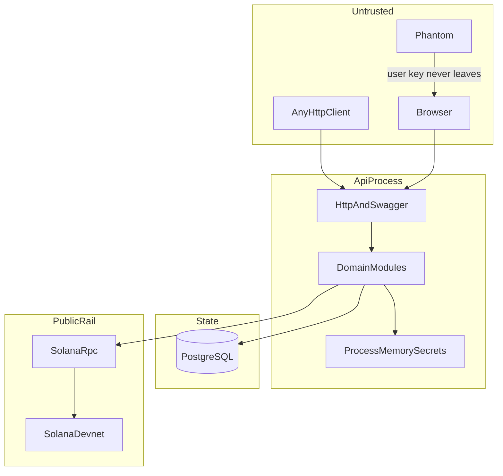

# Threat model

Status: Phase 5 review. This describes assets, boundaries, and abuse of the documented MVP. It does not accept an open `PD-*` item, and it does not implement a control.

Related: [security review](SECURITY_REVIEW.md), [security checklist](SECURITY_CHECKLIST.md), [system architecture](../architecture/SYSTEM_ARCHITECTURE.md), [ADR-002](../decisions/ADR-002-custodial-devnet-treasury.md).

The ledger identity used here is the canonical one:

```text
funded = reserved + paid + refundable + refunded
```

`refundable` is the unallocated principal. `paid` is confirmed solver payouts only. [ADR-008](../decisions/ADR-008-unused-reward-pool-retention.md) retains the unallocated remainder after the deadline or the participant cap as platform revenue and does not add it to `paid`. There is no `unused` bucket. Replacing the right-hand side with `unused` would drop `refunded` and make the identity false. The ledger representation of retained revenue is not specified. Cancelled and never-activated balances remain unspecified.

## Assets

| Asset | Where it lives today | Why it matters |
| --- | --- | --- |
| Treasury signing key | Not in the repo, database, or client. Reserved as `TREASURY_SECRET_KEY` | Anyone who has it can move every Devnet lamport in the custodial wallet |
| Answer-encryption key | Same treatment, as `ANSWER_ENCRYPTION_KEY` | Loss exposes every expected answer. Destruction makes verification and the owner view impossible |
| Expected answer | Not stored yet. Planned column `expectedAnswerCiphertext` | The product fails if solvers can read it before submitting |
| Submitted answer | Not stored yet. Planned plaintext on `SubmissionAttempt` | Research data. Public or cross-creator disclosure breaks PRIV-009's neighbor rules and PD-19. Written explanations are not collected in the MVP ([ADR-009](../decisions/ADR-009-minimal-research-analytics.md)) |
| Session credential | Not issued yet. [ADR-003](../decisions/ADR-003-postgresql-server-side-sessions.md): random token in an HttpOnly cookie; hash on `AuthSession` | Theft impersonates that wallet inside the app. It is not the wallet private key |
| Authentication nonce | Table exists. No writer exists | A reusable nonce allows signature replay |
| Bounty ledger | Tables exist. No writer exists | The chain does not know which bounty owns which lamport. A bad posting pays the wrong wallet or pays twice |
| Creator and solver wallet addresses | Planned `users.wallet_address` | Pseudonymous identifiers. Solana transfers make them public |
| Consent record | Table exists. No writer exists | A session without consent records research the solver did not accept |
| Audit metadata | Table exists. No writer exists | A careless JSON blob can store an answer or a secret |

Devnet SOL has no market price. The loss pattern is still a hot wallet: the same bug on mainnet would be theft. ADR-002 forbids that deployment without a new ADR.

## Trust boundaries



| Boundary | What the code does now | Rule that still applies |
| --- | --- | --- |
| Browser | Static preview. The create form keeps an expected answer in component state and does not send it | Untrusted for correctness, time, eligibility, and payment |
| Phantom | Placeholder only | User keys stay in the wallet. A login signature is not a transfer |
| API process | Serves `/health`, `/health/ready`, and `/docs` | Trusted for the demo once workflows exist. One process holds HTTP and, later, signing |
| Secret config | Loaded into the global config object when set. No module reads the treasury key yet | Treasury key and answer key stay out of Postgres, logs, and the client |
| PostgreSQL | Schema is generated. No migration has been applied | Product source of truth. Chain rows are evidence used to post the ledger once |
| Solana | RPC URL defaults to Devnet. No transfer is built or signed | Public. Destination, source, amount, memo, and commitment are checked before a posting |
| Other creators and solvers | No data API exists | A caller can read only their own private bounty fields, their own attempts, and aggregates the product allows |

The web deploy and the API deploy are different trust zones. ADR-001 keeps the treasury key out of Next.js. That split is intact: `apps/web` does not import a signer.

## External dependencies

| Dependency | Trust placed in it | Failure or compromise |
| --- | --- | --- |
| Phantom, or whichever wallet the user uses | Displays the login message and the deposit transaction | A malicious wallet can trick the user. The API still has to check the signed bytes |
| Solana Devnet RPC | Reports transaction contents and commitment | A lying or stale RPC can activate a bounty or settle a payout that the cluster does not accept. Re-read and pin the commitment |
| PostgreSQL, local or Neon | Stores the ledger and the ciphertext | A database leak exposes ciphertext, plaintext submissions, wallet links, and session hashes |
| The API host | Will hold both secrets in memory | Host compromise is full custody compromise |
| npm packages already pinned | Build and runtime | A compromised package in the API process is inside the trust zone |
| Browser extensions and the developer's machine | Preview only today | A local malware host can read `.env` once an operator creates one |

Privy, Reown, and a hosted SIWS vendor are not dependencies. This model does not add one.

## Actors

| Actor | Capability | Out of scope for the MVP |
| --- | --- | --- |
| Honest creator or solver | Wallet signature, browser, Devnet SOL they actually control | — |
| Malicious solver | Many wallets, replay, parallel submits, crafted bodies, public RPC observation | Becoming a unique human. The product does not claim Sybil resistance |
| Malicious creator | Misleading prompt, deposit of the wrong size, attempt to read another creator's answer | — |
| Unauthenticated caller | Anything the public routes allow | — |
| Compromised API process | Read both secrets, sign transfers, decrypt answers, rewrite the ledger | Surviving that compromise. Custody is operator trust |
| Holder of a leaked treasury key | Move the whole wallet, including every bounty's principal and the fee buffer | On-chain recovery. There is no program |
| Colluding solver and RPC operator | Feed a transaction that does not match the cluster | Accepted only if confirmation re-reads a commitment the product has chosen |
| Another bounty creator | Authenticated, but not the owner | Admin powers. Admin is an allowlist, not a second app |

Wallet uniqueness is one row in `users`, not one person. A person with two Phantom accounts is two users, two attempt budgets, and, if both pass E1, two rewards. That is the rule in the PRD. Rate limits and the per-bounty cap reduce damage. They do not remove it.

## Attack surfaces

### Live now

Verified by reading `apps/api/src` and by the Phase 4 HTTP checks:

- `GET /health` returns process liveness and the service name.
- `GET /health/ready` reports whether a configured database is reachable. The body does not include a connection string.
- `GET /docs` and `/docs-json` publish the OpenAPI document. The document lists those two routes.
- CORS allows the configured origins, defaulting to `http://localhost:3000`.
- JSON bodies are limited by `JSON_BODY_LIMIT`, default `64kb`. No current route reads a body.
- The in-memory rate limiter is constructed and not attached to a route.

There is no login, bounty, submission, funding, or payout route to attack.

### Planned, not built

- Nonce and signature login.
- Session presentation on later requests.
- Bounty create and the owner read of the expected answer.
- Public marketplace DTO.
- Deposit announcement and the confirmation worker.
- Consent, session start, and answer submit.
- Reservation, payout send, and confirmation.
- Owner analytics and, under PD-14, a private wallet-linked view.
- Admin close. That close is not ADR-008 retention.

## Abuse scenarios

| Scenario | What has to be true | Result if the planned control is missing |
| --- | --- | --- |
| Replay a login signature | Captured message plus signature, nonce still active | A second session for that wallet |
| Sign in to the wrong site or chain | Message omits domain, URI, or `solana:devnet` | A signature from another app or from mainnet is accepted |
| Submit the last slot twice | Two wallets pass the cap check before either insert commits | Two allocations, and `reserved` can exceed the cap |
| Same wallet, two correct submits | Unique `(bountyId, solverId)` is not used inside the E1 transaction | Two rewards for one wallet |
| Announce someone else's deposit | Signature is stored without source, destination, memo, and amount checks | The victim's SOL activates the attacker's bounty, or a short payment activates it |
| Retry a payout after a lost RPC response | Worker signs again because no signature was stored | Two transfers for one allocation |
| Read another creator's answer | Public query selects `BountyQuestion`, or an error string includes the plaintext | The challenge is public before anyone solves it |
| Skip consent | Session insert does not require a consent row | Research data is stored without the stated notice |
| Stamp a client clock | `startedAt` or `submittedAt` comes from the body | Completion time and the deadline check are forgeable |
| Drain the fee buffer with principal | Send path treats the whole wallet as spendable fees | Solver payouts or a later refund lack the lamports the ledger still calls `refundable` |
| Sybil the cap | Attacker funds many wallets | Many equal rewards, up to `maxRewardedSolvers` and `refundable`. This is allowed abuse, not a bypass of E1 |

## Financial loss

The chain holds one SOL balance. The ledger is the only split between bounties and between principal and fees.

| Event | Ledger effect | On-chain effect |
| --- | --- | --- |
| Confirmed deposit | `funded` and `refundable` increase once | Treasury balance increases. The memo is what ties it to a bounty |
| E1 reservation | `refundable` decreases, `reserved` increases, one `pending` payout | No transfer yet |
| Confirmed payout | `reserved` decreases, `paid` increases | Treasury pays the solver `rewardLamports`. The fee comes from the buffer |
| Permanent payout failure | `reserved` decreases, `refundable` increases | No successful transfer. The failed signature stays in history |
| ADR-008 retention | Not specified. Do not post the remainder as `paid` | No creator refund after deadline or the participant cap. Not implemented |
| Leaked treasury key | Ledger can still say the lamports exist | The wallet is empty. The ledger and the chain disagree until an operator writes an exception |

A leaked key can take unallocated principal as well as reserved principal. ADR-008 keeps the unallocated remainder with the platform after deadline or the participant cap. A creator does not receive that balance. Cancelled and never-activated balances are not decided.

A reservation that is not yet confirmed must not be counted as `refundable`. Otherwise a refund and a payout can spend the same lamports. The blockchain design already says unconfirmed payouts stay `reserved`.

## Confidentiality and integrity

Confidentiality goals:

- Public JSON never contains the expected answer, its ciphertext, a submitted answer, an explanation, or a session token.
- Decryption runs only for verification and the owning creator's private read.
- Analytics default to aggregates. Wallet-linked rows are a private owner view only if PD-14 is later accepted.
- Logs store ids, status, and public signatures. They do not store answers, authorization headers, or either secret.

Integrity goals:

- The server clock sets `startedAt` and `submittedAt`.
- The server decides `isCorrect`. A client flag is ignored.
- E1 is one database transaction: attempt, allocation, ledger move, and `pending` payout commit together or not at all.
- The transfer is signed after that commit.
- A signature is posted at most once.
- `paid` moves only after the chosen commitment and a match on source, destination, and amount.
- The identity above holds after every committed posting, including a rollback of a failed reservation.

The current process meets none of the workflow goals because those writes do not exist. It does meet the secrecy goal on the routes that exist: health and OpenAPI do not contain an answer or a key.
